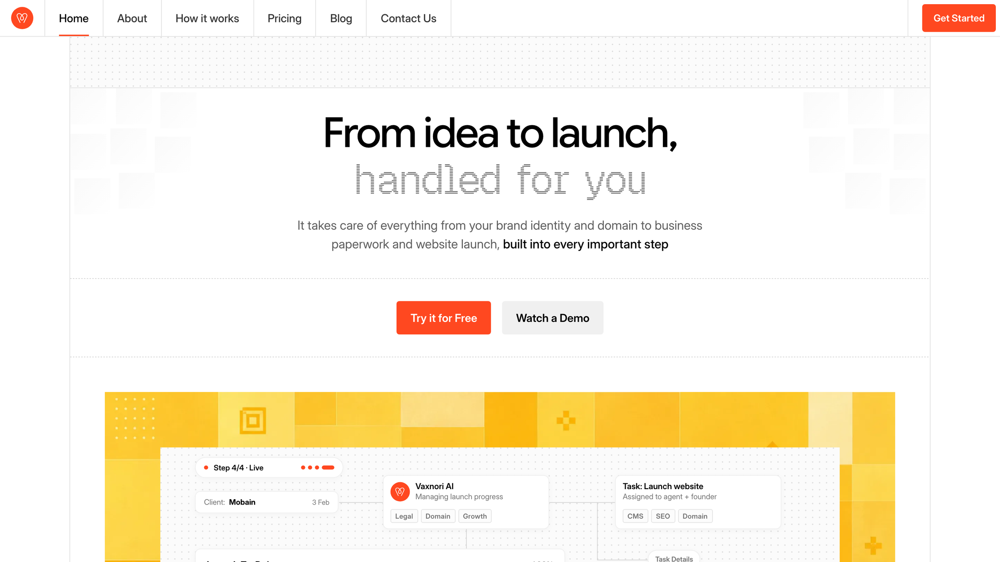
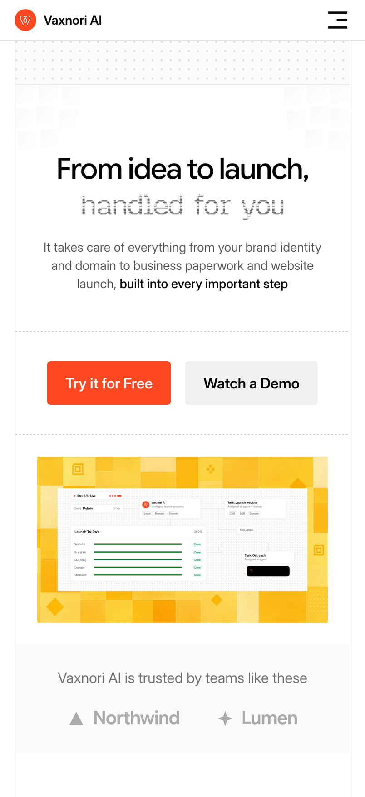

# Vaxnori AI – Astro Theme for AI and SaaS

A free, open-source Astro theme for AI and SaaS products: 13 page types (25 pages with the sample content), smooth animations with almost no JavaScript, an MDX blog and careers section, and a design you can rebrand from one config folder.



**Live demo:** https://vaxnori-astro-theme.vercel.app

No environment variables, no database, no paid services and no server are needed. The theme builds to plain static files and deploys anywhere.

---

## Quick start

Requirements: **Node.js 22.23.4 or newer** (see `.nvmrc`).

```bash
npm create astro@latest -- --template WavespaceAgency/vaxnori-astro-theme
cd <your-project-name>
npm install
npm run dev
```

Open http://localhost:4321.

| Command | What it does |
| --- | --- |
| `npm run dev` | Start the development server |
| `npm run build` | Build the static site into `dist/` |
| `npm run preview` | Preview the production build locally |
| `npm run check` | Type-check the project (`astro check`) |

### Deploy

[](https://vercel.com/new/clone?repository-url=https%3A%2F%2Fgithub.com%2FWavespaceAgency%2Fvaxnori-astro-theme&project-name=vaxnori-astro-theme&repository-name=vaxnori-astro-theme)
[](https://app.netlify.com/start/deploy?repository=https://github.com/WavespaceAgency/vaxnori-astro-theme)

Any static host works (Cloudflare Pages, GitHub Pages, your own server): build command `npm run build`, output folder `dist`.

---

## Features

**Pages**

| Page | What's on it |
| --- | --- |
| Home | Animated product preview, logo marquee, product tabs, stats, how it works, testimonial, feature rows, integrations, FAQ |
| About | Principles, story timeline, stats, team |
| How it works | Video block (opens in a dialog), step-by-step rows, FAQ |
| Pricing | Monthly / annual switch, plan cards, comparison table, FAQ |
| Blog + post | Category filter, "load older posts", reading layout with "On this page", related posts, RSS |
| Careers + job | Tabs with animated mockups, open roles, benefits, hiring process, job page with compensation card |
| Contact | Contact channels, validated form, office card, locations |
| FAQ, Privacy, Terms, 404 | Grouped accordion, legal pages with a sticky contents list |

**Built with**

- **Astro 7** – static output, zero UI framework (no React)
- **Tailwind CSS 4** and **TypeScript** (strict)
- **Motion** (plain JavaScript API) for animations – about 32 KB of JavaScript on the home page, and every animation respects "reduce motion"
- **Content collections** with MDX for blog posts, job posts and legal pages
- **Fontsource** fonts, self-hosted: Inter, Google Sans Flex and Geist Pixel (SIL Open Font License)
- **astro:assets** images: AVIF/WebP, responsive sizes, width and height set (no layout shift)

**Quality**

- Lighthouse (mobile): Performance 99–100, Best Practices 100, SEO 100, Accessibility 96–97 (see [Colours and contrast](#colours-and-contrast))
- Full keyboard support, skip link, visible focus, accessible menu, tabs, accordion and video dialog
- SEO: title, description, canonical URL and Open Graph on every page, sitemap, `robots.txt`, RSS, share image per blog post,
  JSON-LD (Organization, WebSite, FAQPage, BlogPosting, JobPosting)
- Responsive from 320 px to 1920 px, tested at 12 widths with no horizontal scroll
- Content first: all text, links and images are in the HTML (good for SEO); animations and interactions are small scripts added on top



---

## Customisation guide

You can rebrand the whole theme without touching the components.

### 1. Site name, links and footer – `src/config/site.ts`

Name, legal name, description, email, navbar links, mobile menu, footer columns, social links, the main call to action and the two brand marks.

### 2. Page text and data – `src/config/pages/*.ts`

One file per page: `home.ts`, `about.ts`, `how-it-works.ts`, `pricing.ts`, `blog.ts`, `careers.ts`, `contact.ts`, `faq.ts`.
Every heading, paragraph, button, plan, price, FAQ answer and image path lives here.
The animated mockups (hero preview, step cards, feature rows) read their labels, numbers and steps from `home.ts` too.

### 3. Colours, type and spacing – `src/styles/global.css`

All design tokens are CSS variables at the top of the file:

```css
--brand: #ff4820;        /* decorative orange: shapes, icons, fills */
--brand-strong: #ff4820; /* buttons and small orange text */
--ink: #000000;          /* headings */
--muted: #5e5e5e;        /* body text */
--canvas: #fbfbfb;       /* light section background */
--line: #e3e3e3;         /* borders */
```

Change them and the whole site follows. The type scale, radii, shadows and container width are in the `@theme` block below.

### Colours and contrast

The theme uses the exact colours of the original design. White text on the orange `#ff4820` has a contrast of 3.4:1,
which is below the WCAG AA level (4.5:1) for small text. For full WCAG AA contrast, set
`--brand-strong: #cc340b` and `--grey-3: #737373` in `src/styles/global.css`.

### 4. Fonts – `src/styles/global.css`

Fonts come from [Fontsource](https://fontsource.org). To change one, install another package
(for example `npm install @fontsource-variable/manrope`), import it at the top of `global.css`
and update `--font-sans`, `--font-heading` or `--font-pixel`.

### 5. Images and logos

| Location | Contents |
| --- | --- |
| `src/assets/images/` | Page images, grouped by page. Astro optimises them. Config files refer to them as `/images/...` |
| `public/brand/` | `mark.svg` (desktop) and `mark-alt.svg` (mobile, stats) |
| `public/favicon.svg` | Favicon |
| `public/og.png` | Default share image (1200×630) |

The placeholder customer logos on Home are drawn in code – replace `homePage.logos` in `src/config/pages/home.ts`.

### 6. Add a blog post

Create `src/content/blog/my-post.mdx`:

```mdx
---
title: "My first post"
excerpt: "One or two sentences for the card and search engines."
category: "Launch playbooks" # one of the tabs in src/config/pages/blog.ts
date: "2026-10-01"
readingTime: "4 min read"
image: "../../assets/images/blog/my-post.webp" # 1456×800 works best
imageAlt: "Describe the image"
author:
  name: "Your Name"
  avatar: "../../assets/images/blog/author.webp"
---

Write your post in **Markdown**. `## Headings` appear in "On this page".
```

The file name becomes the URL (`/blog/my-post`). The post is added to the blog list, the sitemap and the RSS feed,
and gets its own share image. Set `featured: true` to show it at the top of the blog page.
In MDX you can also use `<Figure>`, `<Callout>` and `<Timeline>` (see `src/components/mdx/`).

### 7. Add a job

Copy any file in `src/content/careers/`, rename it (the file name is the URL) and edit the frontmatter and text.
It appears in the roles table automatically. Use `order` to sort the roles.

### 8. Legal pages

Edit `src/content/legal/privacy.mdx` and `terms.mdx`. The sample text is a placeholder – have it reviewed by your own lawyer.

### 9. Forms

The contact form and the newsletter form check the fields in the browser. To receive the messages, open
`src/components/contact/ContactForm.astro` (`send()`) and `src/components/layout/NewsletterForm.astro` (`subscribe()`)
and connect your provider at the `TODO` (a form service such as Formspree or Web3Forms, Resend, Mailchimp, a webhook, …).

### 10. Video

Add an `.mp4` file or a YouTube/Vimeo embed URL to `video.src` in `src/config/pages/how-it-works.ts`.
The video only loads when someone opens it.

### 11. Site URL

Set `site` in `astro.config.mjs` to your domain (or set the `SITE_URL` environment variable).
It is used for canonical links, the sitemap, RSS and share images. On Vercel the production URL is detected automatically.

### 12. Animations

Add `data-reveal` to any element to fade it in on scroll, or `data-stagger` on a list with `data-stagger-item` on its items.
All options are documented at the top of `src/scripts/motion.ts`.

---

## Project structure

```
src/
  pages/                Routes: pages, blog/[slug], careers/[slug], 404, rss.xml, robots.txt, manifest
  layouts/              BaseLayout.astro – <head>, SEO tags, JSON-LD, header, footer
  components/
    layout/             Header, desktop nav, mobile menu, footer, newsletter form
    sections/           Page sections (hero, pricing, FAQ, CTA, animated mockups, …)
    blog/ careers/ contact/
    mdx/                Styles for MDX content + <Figure>, <Callout>, <Timeline>
    motion/             ScaleToFit (fixed-size mockups that scale on phones)
    ui/                 Button, container, eyebrow, badge, heading, accordion, logo
    icons/              Brand marks, UI icons and line icons
  config/
    site.ts             Name, URL, navigation, footer, socials
    pages/*.ts          Text and data for every page
  content/
    blog/*.mdx          Blog posts
    careers/*.mdx       Job posts
    legal/*.mdx         Privacy and terms
  content.config.ts     Content collections and their fields
  scripts/              motion.ts (scroll reveals, count-up, scale) and loop.ts (mockup loops)
  lib/                  Content helpers, image lookup, SEO helpers, utils
  assets/images/        Optimised images
  styles/global.css     Tailwind, fonts and design tokens
public/                 Brand marks, favicon, share image, SVG patterns
docs/DECISIONS.md       Design and build notes (what changed from the Figma file and why)
```

---

## Credits

- **Design:** Vaxnori AI by [Wavespace](https://www.wavespace.agency)
- **Fonts:** [Inter](https://fonts.google.com/specimen/Inter), [Google Sans Flex](https://fonts.google.com/specimen/Google+Sans+Flex),
  [Geist Pixel](https://fonts.google.com/specimen/Geist+Pixel) – SIL Open Font License 1.1, via Fontsource
- **Images:** AI-generated or made by Wavespace for this theme – free to use with the theme
- **Icons:** custom line icons in `src/components/icons/`
- **Customer logos:** neutral placeholders (Acme, Logoipsum, …) – not real companies

**Footer credit:** the footer shows "Designed & developed by Wavespace". You are free to keep, change or remove it –
edit or delete `credit` in `siteConfig.footer` (`src/config/site.ts`). The MIT license only asks you to keep the
`LICENSE` file, not the footer line.

All names, numbers, quotes and people in the sample content are fictional.

A Next.js version of this design is also available: [vaxnori-nextjs-template](https://github.com/WavespaceAgency/vaxnori-nextjs-template).

## License

[MIT](LICENSE) © 2026 Wavespace
